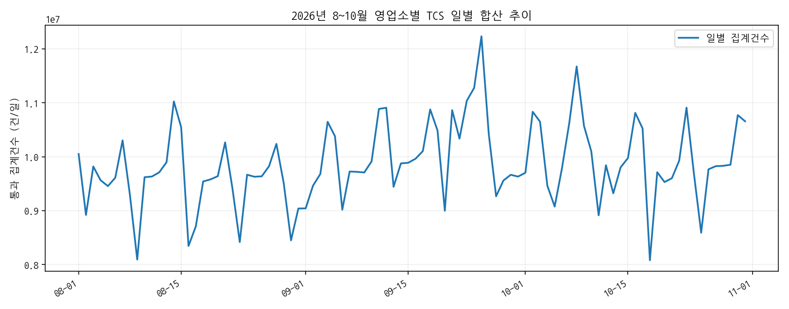
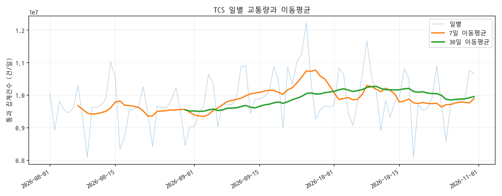
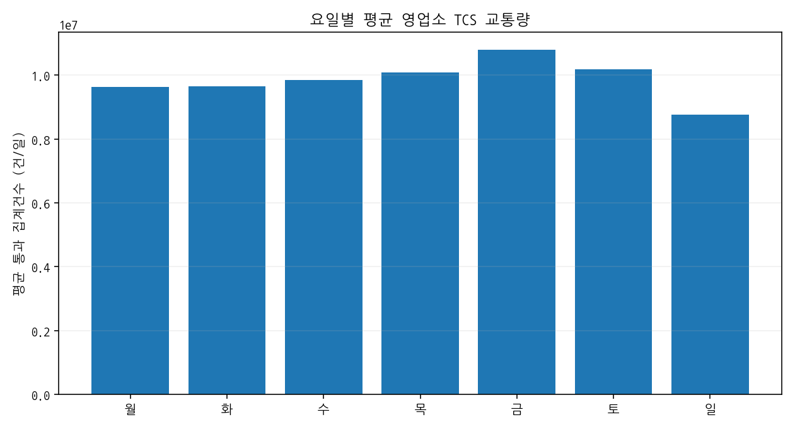
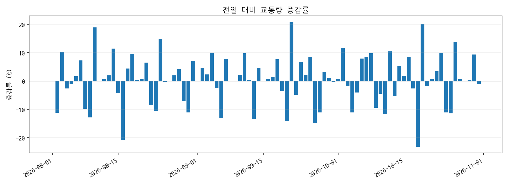
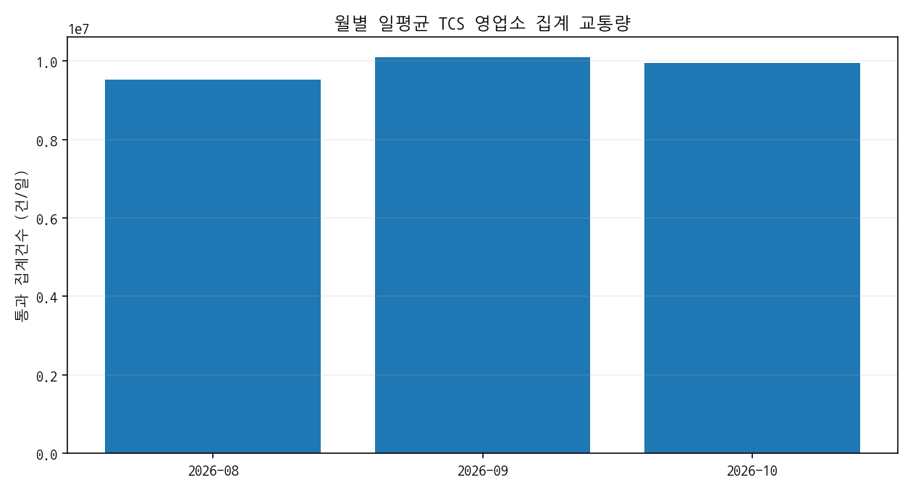

# 고속도로 TCS 영업소별 교통량 데이터 기반 트렌드 분석

## 1. 연구 목적과 개요
2026년 8~10월 한국도로공사 TCS 영업소별 일간 교통량 원본을 이용해 일별 변화, 이동평균, 요일 특성, 월별 평균을 파악한다. 본 분석은 **영업소 통과 집계건수의 추세**를 대상으로 하며 도로 구간 단면 교통량 또는 차량 고유대수 분석과 구분한다.

## 2. 데이터 출처 및 구조
- 출처: 사용자가 한국도로공사 고속도로 공공데이터포털에서 직접 내려받은 `TCS_영업소별교통량_1일_1개월_202608.zip`, `202609.zip`, `202610.zip` (원본명은 `.zip`이지만 내부 포맷은 **gzip 압축된 CP949 CSV**).
- 분석 기간: **2026-08-01 ~ 2026-10-31 (92일)**, 날짜 누락 **0일**.
- 원본 관측치: **164,247행**; 분석 가능한 패널: **85,937개의 날짜×영업소×입출구 코드별 집계 단위**; 구분되는 영업소 코드 **476개**.
- 열: 집계일자, 영업소코드, 입출구구분코드, TCS하이패스구분코드, 고속도로운영기관구분코드, 영업형태구분코드, 1~6종교통량, 총교통량.
- 과제의 100개 이상 데이터 포인트 조건은 **원본 164,247행/패널 85,937개**로 충족한다. 단, **집계 후 일별 시점은 92개뿐**임을 명시한다. 과제에서 ‘시간축 100개 이상’을 요구한다면 이 데이터 3개월만으로 불충분하므로 2026년 7월이나 11월 등 다른 1개월을 추가해야 한다.

## 3. 전처리 및 품질 점검
1. 압축 형식을 gzip으로 인식하고 CP949 문자 인코딩으로 읽었다.
2. 날짜를 ISO 날짜로 변환하고, 영업소 코드는 문자열로 보존하여 선행 0을 유지했다.
3. 고유 키(일자, 영업소, 입출구, TCS/하이패스, 운영기관, 영업형태) 중복 **0건**, 음수 **0건**, 누락·형식오류 **0건**.
4. 1~6종 합계와 총교통량 불일치 **0건**. 누락 날짜 **0일**.
5. 집계 단위를 보존하기 위해 날짜별 `총교통량`을 합산하고, 변화율·7일·30일 이동평균을 계산했다. 이동평균 시작 구간의 값은 **미계산(빈칸)**으로 남겨 임의 보간하지 않았다.
6. 이상징후는 각 날짜 직전 7일 중앙값 대비 ±25% 이상 변화할 때 **검토 플래그**로 표시했다. 변동을 오류로 단정하거나 삭제하지 않았다.

## 4. 분석 결과

| 항목 | 결과 |
|---|---:|
| 기간 전체 영업소 통과 합산 집계건수 | 906,835,368건 |
| 일평균 집계건수 | 9,856,906건/일 |
| 최대 일별 집계 | 2026-09-25, 12,232,853건 |
| 최소 일별 집계 | 2026-10-18, 8,079,829건 |
| 평일 일평균 | 10,003,402건/일 |
| 주말 일평균 | 9,504,231건/일 |
| 주말/평일 평균 차이 | -4.99% |
| 8월 일평균 | 9,529,701건/일 |
| 9월 일평균 | 10,099,940건/일 |
| 10월 일평균 | 9,948,917건/일 |
| 8→10월 일평균 변화 | +4.40% |
| 최초 7일 대비 최종 7일 평균 변화 | +2.32% |
| 최대 전일 대비 증가 | 2026-09-21, +20.74% |
| 최대 전일 대비 감소 | 2026-10-18, -23.23% |

### 4.1 일별 원자료 추이

### 4.2 이동평균으로 본 단기 변화

7일 이동평균은 주간 변동을 완화하고, 30일 이동평균은 상대적으로 완만한 흐름을 보여준다. 실제 차이가 유의한지는 추가 시계열/통계분석이 필요하다.

### 4.3 요일별 특성

요일별 평균에서 최고 요일은 **금요일**(10,797,557건/일), 최저 요일은 **일요일**(8,768,058건/일)이다. 표본은 3개월에 한정되며 공휴일 효과를 통제하지 않았다.

### 4.4 단기 변동률

### 4.5 월별 평균

## 5. 이상징후 점검(삭제 없이 보존)
직전 7일 중앙값 대비 변동폭 ±25% 이상의 **탐색용 플래그 0건**. 이 규칙은 통계적 이상치 확정 기준이 아니라 검토 대상 선별 규칙이다. 아래는 최대 20건이다.

| 날짜 | 일별 집계건수 | 직전 7일 중앙값 대비 |
|---|---:|---:|
| 없음 | - | - |

## 6. AI 보조 해석과 인사이트
- **관측:** 주말 평균은 평일 평균 대비 **-4.99%** 차이가 난다. **해석:** 출퇴근과 주말 이동 수요의 차이가 반영되었을 가능성이 있지만, 통행 목적 데이터가 없어 원인을 확정할 수 없다.
- **관측:** 8월 대비 10월 일평균 집계건수 차이는 **+4.40%**다. **해석:** 월별 일수 차이를 피하고자 총합이 아닌 **일평균**을 비교했다. 3개월 비교이므로 장기적인 성장 또는 감소 추세라고 단정하지 않는다.
- **관측:** 최댓값 날짜는 **2026-09-25**, 최솟값 날짜는 **2026-10-18**다. **가설:** 연휴나 지역·관광 수요가 영향을 줄 수 있지만 기상청 강수량·휴일 캘린더·도로 운영 이력을 결합하기 전에는 검증되지 않는다.
- **활용 방안:** 영업소 통과량의 요일별 차이가 반복되는지 추가 월·연도 데이터로 검증하고, 영업소별로 분리해 혼잡 대응 인력·시설 운영의 기초지표로 활용할 수 있다.

## 7. 한계 및 개선 방향

### 해석할 때 주의할 점
- **이 데이터는 구간 교통량(AADT)이나 서로 다른 차량의 고유대수가 아닙니다.** 영업소별 TCS 입·출구 집계의 합이며 동일 운행이 입구와 출구에서 각각 기록될 가능성이 있습니다. 따라서 단순 합계를 ‘전국 고속도로 이용 차량 수’로 해석하지 않습니다.
- 운영기관 구분·영업형태 코드가 혼합되어 있으며, 영업소 수가 달라질 수 있습니다. 일별 합계 변화에는 집계 대상 또는 운영조건 차이가 일부 포함될 수 있습니다.
- 92일의 일별 시계열만으로 계절성이나 장기적 증가 추세를 확정할 수 없습니다.
- 수치 이상징후는 자동 제거하지 않았습니다. 연휴·행사·운영 변화 등 외부 원인은 별도 자료로 검증해야 합니다.

- 더 강한 분석을 위해 **2026년 7월 자료를 추가**하면 일별 시간점 123개로 확장되어 최소 100개 시점 조건도 안전하게 만족시킬 수 있다.
- 공휴일, 강우량, 노선 ID와 영업소 명칭 매핑이 없어 원인분석·노선별 분석은 수행하지 않았다.
- 실제 교통량 예측이나 인과 추론은 기본 과제 범위에 포함하지 않았다.

## 8. 재현 방법 및 파일
`python -m pip install -r requirements.txt` 다음 `python analysis.py` 실행.

- 원본: `source/*.zip` (gzip 포맷)
- 정제 집계: `data/daily_traffic.csv` (UTF-8 BOM), `data/station_direction_daily.csv`
- 시각화: `figures/*.png`
- Python: `analysis.py`

## 9. 출처
1. 한국도로공사 고속도로 공공데이터포털(`https://data.ex.co.kr`), 영업소별 교통량(TCS) 1일·1개월, 2026년 8~10월 사용자가 제공한 원본 3건.
2. 공공데이터포털 한국도로공사 관련 자료(집계 필드 설명 확인): https://www.data.go.kr/data/15062176/fileData.do. 단, 본 보고서의 수치는 **위의 사용자 제공 원본 3건을 직접 계산한 결과**임.
