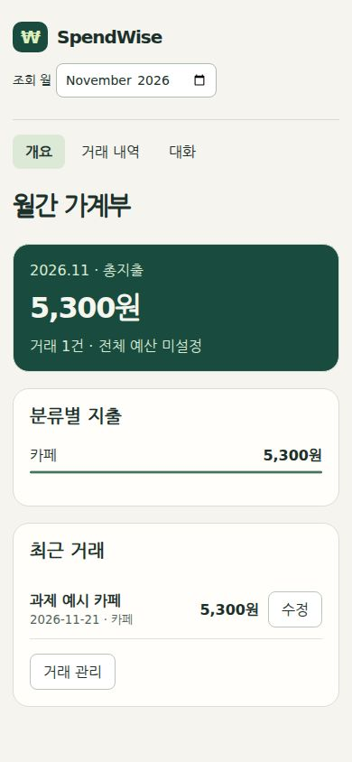
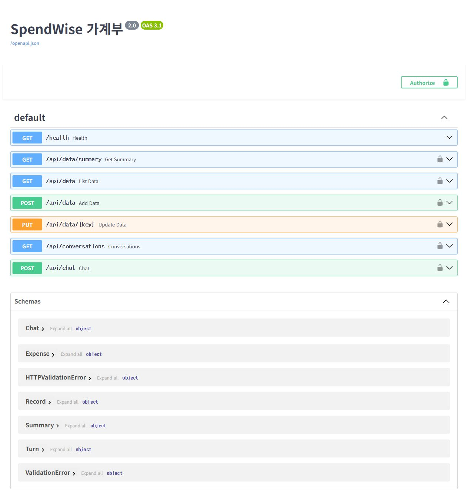
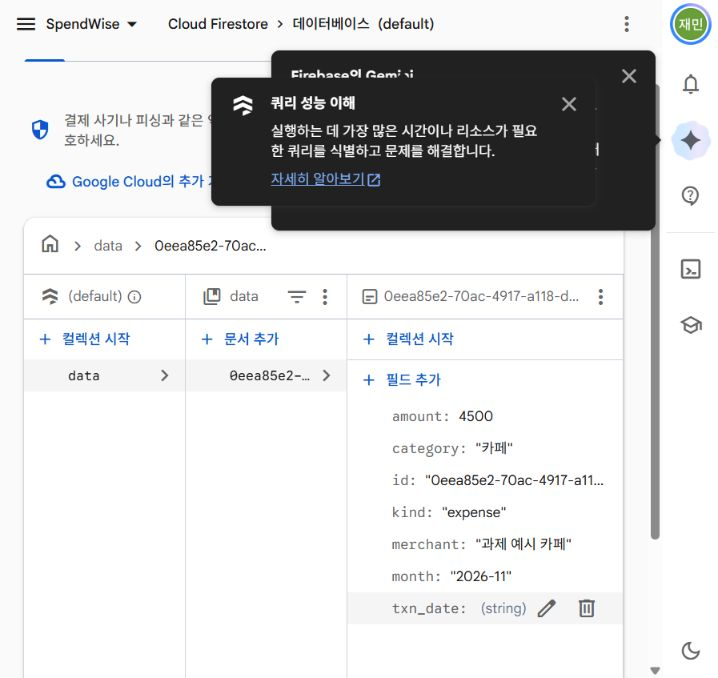
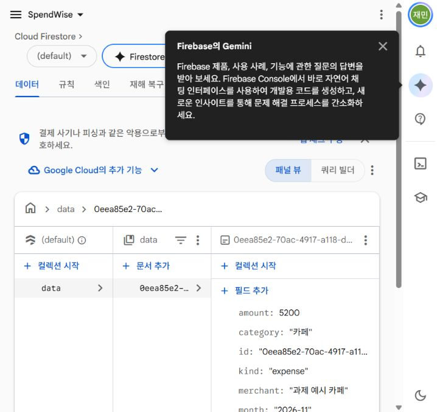

# SpendWise 웹 가계부 재평가 보고서

## #1 배포된 프론트엔드와 백엔드

React 화면과 FastAPI를 하나의 Render 서비스에서 제공한다. 채점자는 가계부에서 비밀번호를 입력하고 조회 월을 **2026년 11월**로 선택하면 예시 거래와 요약을 확인할 수 있다. 서버 상태와 API 명세는 로그인 없이 열린다. [가계부 열기](https://spendwise-f6d6d.onrender.com/) · [서버 상태](https://spendwise-f6d6d.onrender.com/health) · [Swagger 열기](https://spendwise-f6d6d.onrender.com/docs)

2026년 11월 22일 15시 35분(한국 시각), 외부에서 로그인 화면과 `/docs`, `/openapi.json`에 GET 요청을 보내 모두 HTTP 200을 받았다. `/health`는 HTTP 200과 `{"status":"ok"}`를, 인증 없이 요청한 대화 목록은 HTTP 401을 반환했다. URL별 상태 코드와 응답을 기록했다. [공개 HTTP 응답 원본](evidence/deployed-http.json)

아래 두 장은 공개 서비스에서 확인한 월간 개요와 API 문서다.

## #3 실제 Firestore 쓰기와 재조회

11월 22일 15시 40분(한국 시각), 검증용 거래의 금액 필드에 현재 값 5,300원을 다시 쓰고 즉시 읽었다. Firestore가 PATCH와 GET 모두 HTTP 200과 같은 금액을 반환했다. 쓰기 요청에 직전 수정 시각을 조건으로 넣어 동시에 변경된 값을 덮어쓰지 않도록 했다. 아래 표와 콘솔 캡처는 금액 자체가 바뀐 앞선 실행 기록이다. [PATCH 본문·응답과 GET 원본](evidence/firestore-write-read.json) · [실행 캡처](evidence/submission-verification.jpg)

프로젝트 `spendwise-f6d6d`의 예시 거래 한 건을 따라갔다. Firestore 콘솔에서 같은 문서 ID의 금액을 비교하면 최초 등록과 수정 결과를 확인할 수 있다.

| 관찰 시점 | 대상 | 실제 확인값 |
|---|---|---|
| 최초 등록 | `data/0eea85e2-70ac-4917-a118-de950b170001` | 4,500원 |
| 수정 후 콘솔 재조회 | 같은 문서 | 5,200원 |
| FastAPI로 5,300원 수정 후 별도 조회 | 거래 목록, Firestore 문서 직접 읽기, 2026-11 월 합계 | 거래와 월 합계가 각각 5,200원에서 5,300원으로 변경 |
| 요약 대화 저장 후 읽기 | `conversations/ea776e3c-5910-4b2a-91af-bc54a4c90001` | `summarize`, “2026-11 지출은 1건, 총 5,300원입니다.” |

11월 22일에는 Google Firestore REST API로 위의 두 문서를 다시 읽었다. 두 GET 모두 HTTP 200이었다. 거래 문서의 `amount.integerValue`는 `5300`, 대화 문서의 `reply.stringValue`에는 같은 달 1건·5,300원이 남아 있었다. 기록의 `firestore_readback`에는 Google이 반환한 문서 경로, 필드 및 마지막 수정 시각이 있다. [Firestore 직접 재조회 응답](evidence/deployed-http.json)

Cloud Shell의 검증 프로그램은 실제 Firestore 클라이언트를 사용했다. FastAPI에 PUT을 보낸 뒤 거래 목록과 요약을 다시 요청하고, Firestore에서 같은 ID를 직접 읽어 대조했다. 이어 POST로 반환된 대화가 GET 목록과 Firestore 문서에도 있는지 확인했다. 검증 시각과 금액·답변은 JSON에 보존했다. [실측 JSON](evidence/live-firestore-api.json) · [검증 프로그램](verify_firestore.py) · [배포 앱의 대화 화면](evidence/render-chat.jpg)

## #8 컬렉션을 둘로 나눈 이유

| 컬렉션 | 문서 키와 주요 필드 | 쓰기·읽기와 인덱스 |
|---|---|---|
| `data` | 지출은 UUID. `txn_date`, `merchant`, `amount`, `category`, `month`, `kind=expense`를 저장한다. 예산은 `budget-{month}-{category}`에 `kind=budget`과 금액을 저장한다. | 지출은 같은 상호·금액이라도 각각 기록한다. 예산은 같은 월·분류로 다시 설정하면 한 문서를 갱신한다. 월 단일 필드 동등 조건으로 한 달치를 읽고 서버에서 종류를 나누어 집계한다. |
| `conversations` | 요청 UUID를 문서 키로 사용한다. 선택 월, 서버 UTC 시각, 질문, 답변, 도구, 감사 기록, 스키마 버전을 저장한다. | 성공한 턴마다 문서 하나를 생성한다. 최근 기록은 `created_at` 내림차순 단일 필드 인덱스와 limit으로 가져온다. 요청 ID 재조회는 문서 키로 직접 읽는다. |

예산과 거래는 같은 월을 한 번 조회해 잔액까지 계산할 수 있다. 대화는 월 집계와 독립적으로 최신순 조회가 필요해 별도로 저장한다. 날짜에서 파생한 `month`를 중복 저장하면 월별 검색이 단순해지지만 날짜를 수정할 때 두 값이 어긋날 수 있다. 서버가 등록과 수정 모두에서 거래일로 월을 다시 계산한다. 현재 쿼리는 각각 단일 필드를 사용한다. 한 달의 거래 수가 커지면 요약 요청당 읽는 문서 수도 늘어난다. [저장 및 쿼리 구현](web_store.py) · [월 이동 회귀 테스트](tests/test_web.py)

## #11 Claude에 주는 컨텍스트의 효과와 한계

첫 모델 요청에는 서버가 계산한 선택 월의 요약 JSON을 시스템 지침과 함께 넣는다. 최근 대화 최대 6턴은 시간순 메시지로 전달한다. 사용자가 “이번 달”이라고 했을 때 화면과 같은 월의 총액을 참조할 수 있다. 금액을 모델이 추측할 가능성은 줄지만 답변의 정확성이 보장되지는 않는다. 허용된 도구 한 번만 실행하고 인자를 검증하며, 최종 답변에는 도구 결과를 제공한다. [모델 호출 코드](agent.py) · [모의 호출의 시스템 지침과 도구 결과](evidence/claude-mock.json)

| 영향 | 대가와 대응 |
|---|---|
| 속도·비용 | 요약을 만들 때 Firestore에서 그 달의 문서를 읽고 대화 이력만큼 입력 토큰이 늘어난다. 이력은 6턴으로 제한한다. 정해진 요약 명령은 모델 호출 없이 처리한다. 이번 검증에서는 Claude 실사용 지연·요금이나 정확도 향상률을 계측하지 않았다. |
| 프라이버시 | 월 합계·예산과 대화 속 상호명·금액이 모델에 전달될 수 있다. 집계 JSON에는 개별 거래 목록을 넣지 않고, 사용자가 AI 모드를 선택한 경우에 모델을 호출한다. 자유 입력 이력에는 민감 정보가 남을 수 있어 시연에는 가상 거래를 사용한다. |
| 보안 | 대화 이력에는 사용자가 작성한 지시가 포함될 수 있다. 서버가 도구명·인자·개수와 쓰기 의사 표현을 검사한다. 현재는 단일 공유 장부이므로 인증된 이용자끼리 대화 이력을 공유한다. |

## #12 요약 API를 분리한 이유

`GET /api/data/summary?month=2026-11`은 인증 후 월 합계, 건수, 분류별 합계, 예산과 잔액을 구조화해 반환한다. 서버의 `summary()`가 금액 계산을 맡고 프론트엔드는 원화 표시와 차트 렌더링을 맡는다. 월 경계나 예산 산식을 고칠 위치가 한 곳이므로 개요·대화 답변의 계산이 서로 달라질 위험이 줄어든다.

예를 들어 거래 수정 후 React 개요는 이 API를 다시 호출해 합계를 갱신한다. 채팅의 `summarize` 도구와 모델 요청 전 컨텍스트 생성은 같은 함수를 서버 안에서 직접 사용한다. 추후 월간 리포트를 만들 때도 같은 HTTP 응답을 사용할 수 있다. [실제 요약 전후 값](evidence/live-firestore-api.json) · [응답 필드 예시](evidence/local-api.json) · [API와 도구 연결](web_api.py)

## #13 대화 저장 시점, 감사 기록, 동시 요청

서버는 요청 ID로 기존 턴을 먼저 찾는다. 새 요청이면 도구가 만든 장부 변경과 `audit`를 메모리에 모으고, 답변이 정해진 뒤 응답을 보내기 전에 장부 변경과 대화를 Firestore 배치 한 번으로 커밋한다. 도구 실행 전 검증 오류는 저장하지 않는다. 구조화한 `audit.tool`, `audit.args`, `audit.result`로 어떤 입력이 어떤 결과를 냈는지 확인할 수 있다. 도구 기록이 없는 턴의 audit는 비어 있을 수 있다. 대화 목록 API는 질문·답변·도구명 등 화면에 필요한 필드만 반환한다.

같은 요청 ID·월·메시지를 재전송하면 기존 답변을 돌려준다. 두 요청이 동시에 사전 조회를 통과해도 대화 문서의 `batch.create`는 한 번만 성공하고, 다른 배치의 장부 변경도 함께 취소된다. 서버는 저장된 턴을 다시 읽으며 같은 ID에 다른 월이나 메시지를 사용하면 HTTP 409로 거절한다. 이 처리는 저장 중복을 막는다. 동시에 시작된 AI 요청의 외부 호출까지 한 번으로 제한하지는 않는다. 새 요청 ID로 보낸 동일 문장은 별도 대화로 취급한다. [배치 커밋](web_store.py) · [재시도·충돌 테스트](tests/test_web.py)
